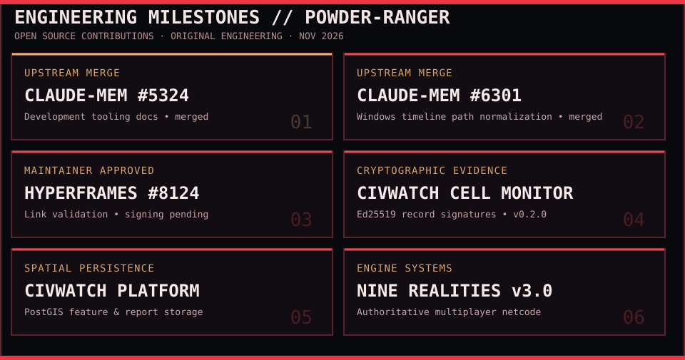

# Curtis Charles Farrar
### POWDER-RANGER · SYSTEMS ARCHITECTURE · SECURITY ENGINEERING · AI GOVERNANCE

> **I build practical systems for security, automation, AI, and public-interest technology.** My focus is reliable software, thoughtful engineering, and solutions that hold up beyond a demonstration.

**Explore my work:** [Open-source contributions](https://github.com/thedotmack/claude-mem/pull/6301) · [CIVWATCH](https://github.com/POWDER-RANGER/CivilianIntelligence) · [Project websites](https://powder-ranger.github.io/pages.html)

## Open-source contributions

I contribute fixes and improvements to tools I use, with a focus on reliability, cross-platform behavior, and maintainability.

| Project | Contribution | Result |
|:--|:--|:--|
| **[Claude-Mem](https://github.com/thedotmack/claude-mem/pull/6301)** | Cross-platform timeline labels | **Merged · Nov 18, 2026** |
| **[Claude-Mem](https://github.com/thedotmack/claude-mem/pull/5324)** | Development setup and test documentation | **Merged · Nov 4, 2026** |
| **[Hyperframes](https://github.com/heygen-com/hyperframes/pull/8124)** | Validate missing and mis-cased Markdown links | **Maintainer-approved · signing pending** |

### Additional upstream work

I've contributed to [Hyperframes skill documentation](https://github.com/heygen-com/hyperframes/pull/7079), [Vercel Skills registry handling](https://github.com/vercel-labs/skills/pull/2780), and [MetaHuman DNA Calibration](https://github.com/EpicGames/MetaHuman-DNA-Calibration/pulls?q=is%3Apr+author%3APOWDER-RANGER).

My [Claude-Mem recovery investigation](https://github.com/thedotmack/claude-mem/pull/6316) also helped narrow a proposed reliability fix. The original approach was closed after maintainer feedback, with a simpler follow-up suggested.

## Selected projects

These are the systems I'm building and improving. Each project links to its source, technical work, or public interface.

### CIVWATCH — public evidence and civic transparency

**[CivilianIntelligence](https://github.com/POWDER-RANGER/CivilianIntelligence)** is my public-interest technology project focused on making civic oversight information easier to find and understand. It brings together source-backed records, mapping, and tools for examining surveillance infrastructure and government accountability. Recent development has focused on authentication, API security, clearer data provenance, map performance, and 3D visualization.

[Live web app](https://civintelligence.onrender.com/) · [Project site](https://powder-ranger.github.io/CIVWATCH/) · [Platform services](https://github.com/POWDER-RANGER/civwatch-watchtower) · [Cell Monitor](https://github.com/POWDER-RANGER/civwatch-cell-titan) · [Flutter client](https://github.com/POWDER-RANGER/civwatch-app)

**Selected technical work:**

- [Cell Monitor PR #15](https://github.com/POWDER-RANGER/civwatch-cell-titan/pull/15): Ed25519-signed evidence records, verification and public-key export.
- [Platform PR #14](https://github.com/POWDER-RANGER/civwatch-watchtower/pull/14): PostGIS-backed feature/report persistence and a first server test suite.
- [CIVWATCH security PR #91](https://github.com/POWDER-RANGER/CivilianIntelligence/pull/91): API contracts, validated proxy configuration, rate limiting and security headers.

### Nine Realities Netcode — distributed multiplayer systems

**[Nine Realities Netcode](https://github.com/POWDER-RANGER/nine-realities-netcode)** explores server-authoritative simulation, client prediction, rollback, reconciliation and adaptive synchronization for Unreal Engine. The repository documents a v3.0 Unreal Engine 5.5+ plugin and UE6 forward-compatibility work. [Technical presentation](https://powder-ranger.github.io/nine-realities-netcode/).

### AI, automation, and defensive systems

- **[OBLISK](https://github.com/POWDER-RANGER/OBLISK)** — multi-agent orchestration, symbolic planning, AES-GCM vault work and observability. Active development.
- **[RED-AGENT-GOV](https://github.com/POWDER-RANGER/RED-AGENT-GOV)** — deterministic finite-state governance, D01–D06 directive gates and hash-linked audits.
- **[NSO Kryptonite](https://github.com/POWDER-RANGER/nso-kryptonite-platform)** — an authorized synthetic purple-team/training range. 
- **[Æther / PR-REX](https://github.com/POWDER-RANGER/aether-platform)** — local-first gaming accessibility and controlled agent research.

## GitHub activity

A snapshot of my recent public work, alongside the contribution history GitHub maintains.

[View my contribution history](https://github.com/POWDER-RANGER?tab=overview)

### Recent public activity

<!--START_SECTION:activity-->
<!--END_SECTION:activity-->

## Achievements and milestones

My [official GitHub achievements](https://github.com/POWDER-RANGER?tab=achievements) are displayed on my GitHub profile, including the badges I've earned through collaboration and contributions. Below is a separate collection of engineering milestones from my work.

## Tools and technologies

## Project websites

**[Explore the complete project directory](https://powder-ranger.github.io/pages.html)**

| Destination | Focus |
|---|---|
| [Main portfolio](https://powder-ranger.github.io/) | Profile and projects |
| [Repository explorer](https://powder-ranger.github.io/repos.html) | Repository browsing |
| [CIVWATCH project site](https://powder-ranger.github.io/CIVWATCH/) | Sourced civic transparency |
| [Nine Realities](https://powder-ranger.github.io/nine-realities-netcode/) | Multiplayer networking research |
| [OBLISK](https://powder-ranger.github.io/OBLISK/) | Multi-agent systems |
| [RED-AGENT-GOV](https://powder-ranger.github.io/RED-AGENT-GOV/) | Agent governance |
| [NSO Kryptonite](https://powder-ranger.github.io/nso-kryptonite-platform/) | Synthetic adversarial defense range |
| [Games hub](https://powder-ranger.github.io/games/) | Interactive game pages |

## Other work

I keep experiments, earlier prototypes, and reference repositories available alongside my active projects. Forked projects retain credit to their original maintainers; my own changes are documented through their commits and pull requests.

Additional projects include [RainGod Comfy Studio](https://github.com/POWDER-RANGER/RainGod-Comfy-Studio), [POWDER-RANGER Stone](https://github.com/POWDER-RANGER/powder-ranger-stone), and [Contextual Memory UI](https://github.com/POWDER-RANGER/contextual-memory-ui).

## About me

I'm a self-taught developer and systems engineer with a background in hands-on technical work. I work across security, AI, automation, and distributed systems, and I enjoy solving problems that cross the boundaries between software, infrastructure, and real-world operations.

I care about clear documentation, reproducible tests, secure design, and building software that people can actually use.

**Connect:** [Portfolio](https://powder-ranger.github.io/) · [LinkedIn](https://www.linkedin.com/in/curtis-farrar-20aa3525b) · [ORCID](https://orcid.org/0009-0008-9273-2458)
